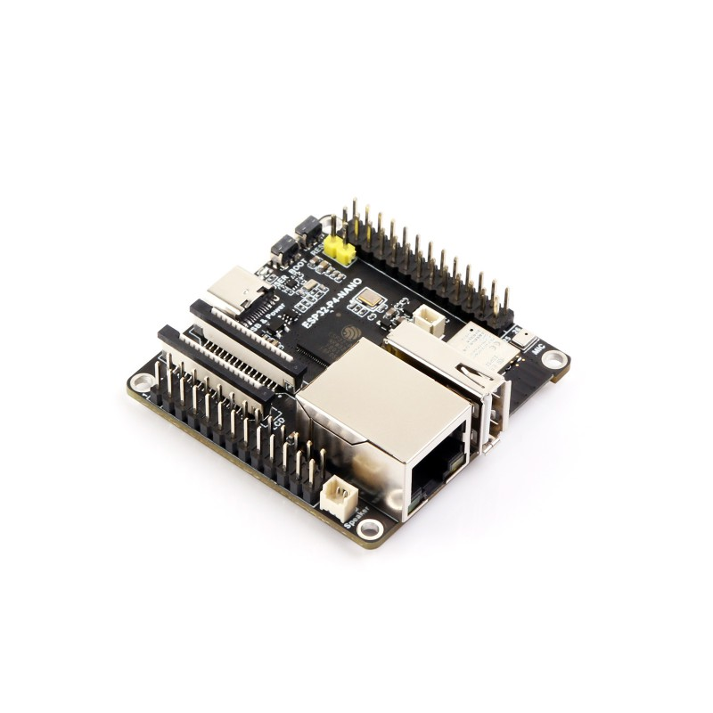
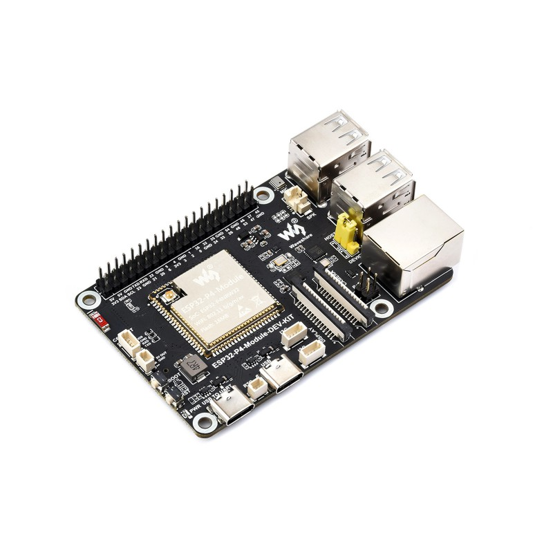
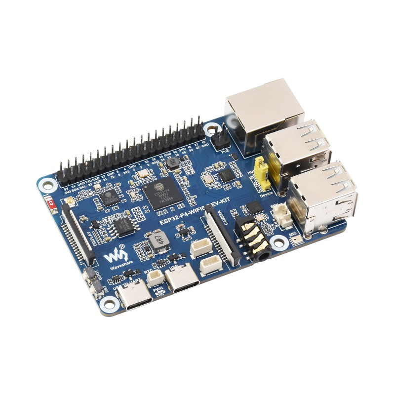
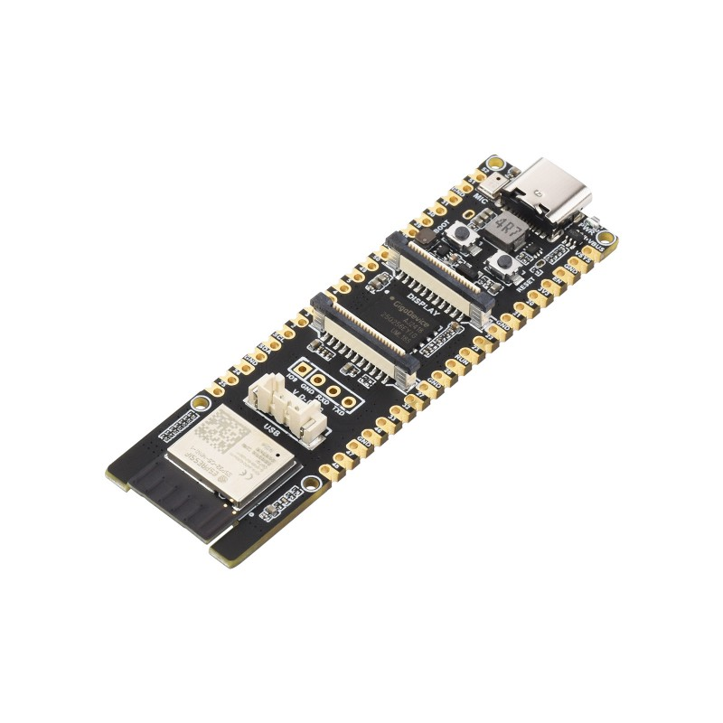
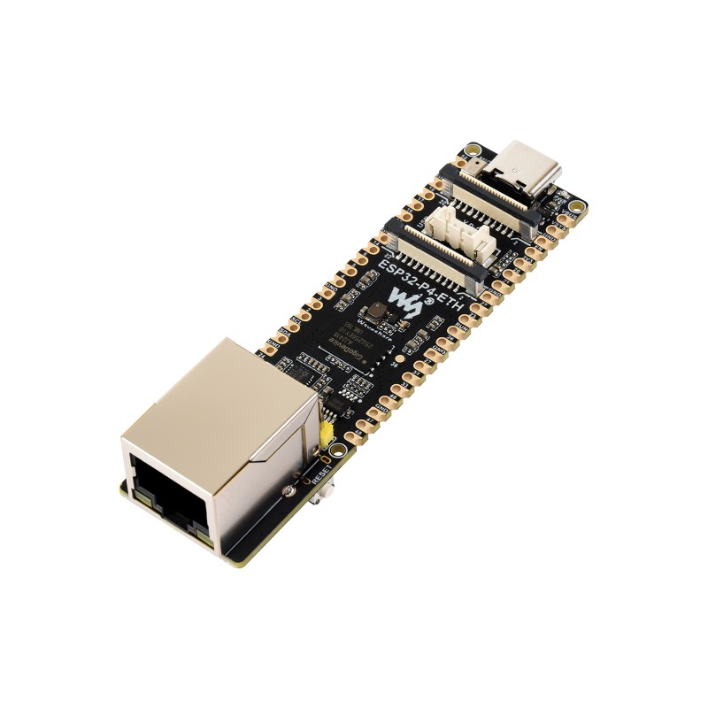
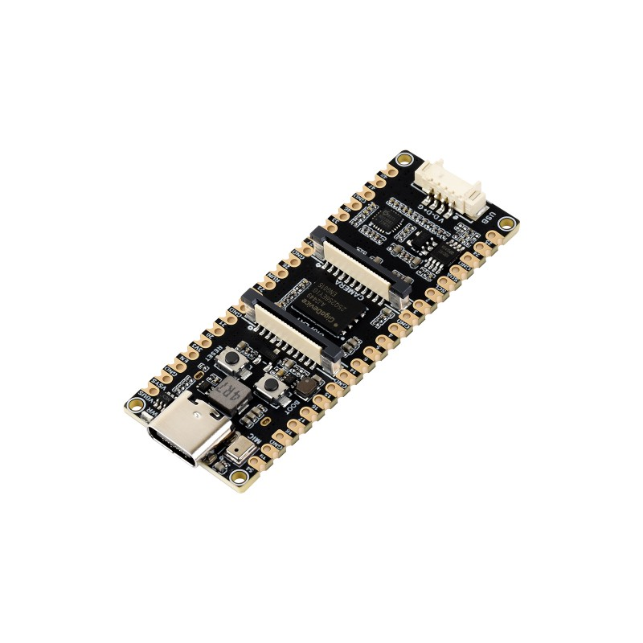
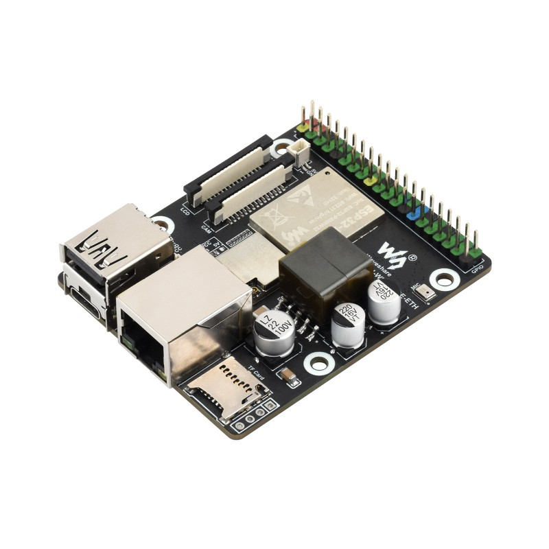
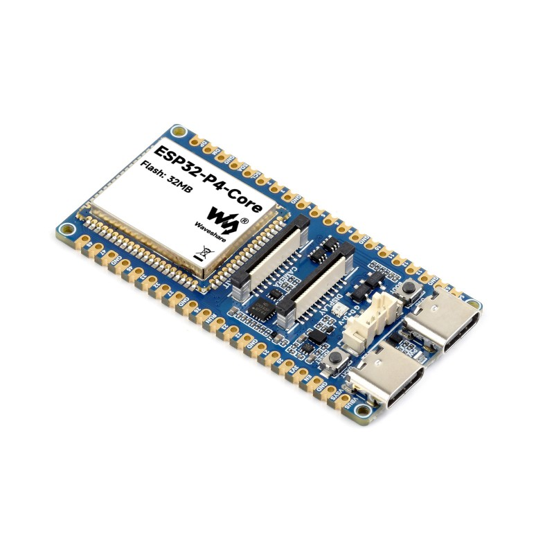

  <h1>ESP32-P4-Platform</h1>
  
<strong>Peripheral and multimedia examples for Waveshare ESP32-P4 boards</strong>

  
<strong>English</strong> | <a href="README_ZH.md">简体中文</a>

  

    
    
    
  

  

    <a href="https://www.waveshare.com/catalogsearch/result/?q=ESP32-P4">🛒 Product</a> &middot;
    <a href="https://github.com/waveshareteam/ESP32-P4-Platform/releases/latest">📦 Firmware</a> &middot;
    <a href="examples/esp-idf/">🧩 ESP-IDF</a> &middot;
    <a href="examples/arduino/examples/">🔧 Arduino</a> &middot;
    <a href="https://docs.waveshare.com/ESP32-P4">📖 Documentation</a>
  

<table>
  <tr>
    <td align="center" width="25%">
      <a href="https://www.waveshare.com/esp32-p4-nano.htm"> <strong>ESP32-P4-NANO</strong></a> 
      <a href="https://docs.waveshare.com/ESP32-P4-NANO">Guide</a>
    </td>
    <td align="center" width="25%">
      <a href="https://www.waveshare.com/esp32-p4-module-dev-kit.htm"> <strong>ESP32-P4-Module-DEV-KIT</strong></a> 
      <a href="https://docs.waveshare.com/ESP32-P4-Module-DEV-KIT">Guide</a>
    </td>
    <td align="center" width="25%">
      <a href="https://www.waveshare.com/esp32-p4-wifi6-dev-kit.htm"> <strong>ESP32-P4-WIFI6-DEV-KIT</strong></a> 
      <a href="https://docs.waveshare.com/ESP32-P4-WIFI6-DEV-KIT">Guide</a>
    </td>
    <td align="center" width="25%">
      <a href="https://www.waveshare.com/esp32-p4-wifi6.htm"> <strong>ESP32-P4-WIFI6</strong></a> 
      <a href="https://docs.waveshare.com/ESP32-P4-WIFI6">Guide</a>
    </td>
  </tr>
  <tr>
    <td align="center" width="25%">
      <a href="https://www.waveshare.com/esp32-p4-eth.htm"> <strong>ESP32-P4-ETH</strong></a> 
      <a href="https://docs.waveshare.com/ESP32-P4-ETH">Guide</a>
    </td>
    <td align="center" width="25%">
      <a href="https://www.waveshare.com/esp32-p4-pico.htm"> <strong>ESP32-P4-Pico</strong></a> 
      <a href="https://docs.waveshare.com/ESP32-P4-Pico">Guide</a>
    </td>
    <td align="center" width="25%">
      <a href="https://www.waveshare.com/esp32-p4-wifi6-poe-eth.htm"> <strong>ESP32-P4-WIFI6-POE-ETH</strong></a> 
      <a href="https://docs.waveshare.com/ESP32-P4-WIFI6-POE-ETH">Guide</a>
    </td>
    <td align="center" width="25%">
      <a href="https://www.waveshare.com/esp32-p4-core-dev-kit.htm"> <strong>ESP32-P4-Core-DEV-KIT</strong></a> 
      <a href="https://docs.waveshare.com/ESP32-P4-Core-DEV-KIT">Guide</a>
    </td>
  </tr>
</table>

---

## ✨ Overview

This repository provides ESP-IDF and Arduino examples plus factory-demo source for the Waveshare ESP32-P4 board family, covering basic peripherals, networking, audio, displays, touch and cameras. Select the actual board and accessories using the product guides above.

| Feature | Device / interface |
| --- | --- |
| MCU | ESP32-P4, dual-core RISC-V |
| Memory | 16 MB or 32 MB Flash and 32 MB PSRAM, depending on the board; see each board's official specifications |
| Networking | Ethernet and ESP32-C6 remote Wi-Fi, depending on the board |
| Display and camera | Compatible MIPI-DSI displays and MIPI-CSI cameras, as required by each example |
| Board support | Managed `waveshare/esp32_p4_platform` component for ESP-IDF; bundled libraries for Arduino |

## 📦 Quick Start

Start with [00_board_check](examples/esp-idf/00_board_check/) and follow its README to build, flash and inspect the serial log.

1. Install a framework version from the table below and clone this repository.
2. Select the silicon profile using the [revision guide](docs/ESP32P4_REVISION_CONFIG.md); v3.x is the default.
3. Open an example and follow its README to configure the actual peripherals and run it.

When example firmware has been published, download its `*-combined.zip` from the [latest release](https://github.com/waveshareteam/ESP32-P4-Platform/releases/latest), extract it and follow the included README. Factory-demo source is in [examples/factory](examples/factory/).

## 🧪 Examples

### ESP-IDF

| Example | Main feature |
| --- | --- |
| [00_board_check](examples/esp-idf/00_board_check/) | Board Check |
| [01_HowToCreateProject](examples/esp-idf/01_HowToCreateProject/) | How to Create a Project |
| [02_HelloWorld](examples/esp-idf/02_HelloWorld/) | Hello World |
| [03_nvs_counter](examples/esp-idf/03_nvs_counter/) | NVS Counter |
| [04_freertos_tasks](examples/esp-idf/04_freertos_tasks/) | FreeRTOS Tasks |
| [05_gpio_io](examples/esp-idf/05_gpio_io/) | GPIO Input and Output |
| [06_gpio_interrupt](examples/esp-idf/06_gpio_interrupt/) | GPIO Interrupt |
| [07_uart_loopback](examples/esp-idf/07_uart_loopback/) | UART Loopback |
| [08_i2c_tools](examples/esp-idf/08_i2c_tools/) | I2C Tools |
| [09_sdmmc](examples/esp-idf/09_sdmmc/) | SDMMC |
| [10_wifistation](examples/esp-idf/10_wifistation/) | Wi-Fi Station |
| [11_ethernetbasic](examples/esp-idf/11_ethernetbasic/) | Ethernet Basic |
| [12_I2SCodec](examples/esp-idf/12_I2SCodec/) | I2S Codec |
| [13_Displaycolorbar](examples/esp-idf/13_Displaycolorbar/) | Display Color Bar |
| [14_lvgl_demo_v9](examples/esp-idf/14_lvgl_demo_v9/) | LVGL v9 Demo |
| [15_eth2ap](examples/esp-idf/15_eth2ap/) | Ethernet to Wi-Fi AP |
| [16_video_lcd_display](examples/esp-idf/16_video_lcd_display/) | Camera to LCD |
| [17_simple_video_server](examples/esp-idf/17_simple_video_server/) | Simple Video Server |
| [18_esp_brookesia_phone](examples/esp-idf/18_esp_brookesia_phone/) | ESP-Brookesia Phone |
| [19_system_monitor](examples/esp-idf/19_system_monitor/) | System Monitor |

### Arduino

| Example | Main feature |
| --- | --- |
| [HelloWorld](examples/arduino/examples/HelloWorld/) | Hello World |
| [AsciiTable](examples/arduino/examples/AsciiTable/) | ASCII Table |
| [Drawing_board](examples/arduino/examples/Drawing_board/) | Drawing Board |
| [GFX_ESPWiFiAnalyzer](examples/arduino/examples/GFX_ESPWiFiAnalyzer/) | Wi-Fi Analyzer |
| [LVGLV9_Arduino](examples/arduino/examples/LVGLV9_Arduino/) | LVGL v9 |
| [Camera_Preview](examples/arduino/examples/Camera_Preview/) | Camera Preview |
| [Camera_ISP_Tuning](examples/arduino/examples/Camera_ISP_Tuning/) | Camera ISP Tuning |
| [SD_Card](examples/arduino/examples/SD_Card/) | SD Card |
| [Audio_Playback](examples/arduino/examples/Audio_Playback/) | Audio Playback |

See the [Arduino setup](examples/arduino/README.md); sketch dependencies are bundled in [examples/arduino/libraries](examples/arduino/libraries/).

### ESP-IDF Board Compatibility

Legend: `✅` means the example is expected to run on that board. `❌` means
the required peripheral is not available or is not supported by the example.

> [!NOTE]
> This matrix summarizes the repository's current example support declarations.
> CI checks compilation; use the official product documentation above to verify
> board-specific interfaces and hardware setup.

| No. | Example | ESP32-P4-NANO | ESP32-P4-Module-DEV-KIT | ESP32-P4-WIFI6-DEV-KIT | ESP32-P4-WIFI6 | ESP32-P4-ETH | ESP32-P4-Pico | ESP32-P4-WIFI6-POE-ETH | ESP32-P4-Core-DEV-KIT |
| --- | --- | :---: | :---: | :---: | :---: | :---: | :---: | :---: | :---: |
| 00 | [board_check](examples/esp-idf/00_board_check/) | ✅ | ✅ | ✅ | ✅ | ✅ | ✅ | ✅ | ✅ |
| 01 | [HowToCreateProject](examples/esp-idf/01_HowToCreateProject/) | ✅ | ✅ | ✅ | ✅ | ✅ | ✅ | ✅ | ✅ |
| 02 | [HelloWorld](examples/esp-idf/02_HelloWorld/) | ✅ | ✅ | ✅ | ✅ | ✅ | ✅ | ✅ | ✅ |
| 03 | [nvs_counter](examples/esp-idf/03_nvs_counter/) | ✅ | ✅ | ✅ | ✅ | ✅ | ✅ | ✅ | ✅ |
| 04 | [freertos_tasks](examples/esp-idf/04_freertos_tasks/) | ✅ | ✅ | ✅ | ✅ | ✅ | ✅ | ✅ | ✅ |
| 05 | [gpio_io](examples/esp-idf/05_gpio_io/) | ✅ | ✅ | ✅ | ✅ | ✅ | ✅ | ✅ | ✅ |
| 06 | [gpio_interrupt](examples/esp-idf/06_gpio_interrupt/) | ✅ | ✅ | ✅ | ✅ | ✅ | ✅ | ✅ | ✅ |
| 07 | [uart_loopback](examples/esp-idf/07_uart_loopback/) | ✅ | ✅ | ✅ | ✅ | ✅ | ✅ | ✅ | ✅ |
| 08 | [i2c_tools](examples/esp-idf/08_i2c_tools/) | ✅ | ✅ | ✅ | ✅ | ✅ | ✅ | ✅ | ✅ |
| 09 | [sdmmc](examples/esp-idf/09_sdmmc/) | ✅ | ✅ | ✅ | ✅ | ✅ | ✅ | ✅ | ❌ |
| 10 | [wifistation](examples/esp-idf/10_wifistation/) | ✅ | ✅ | ✅ | ✅ | ❌ | ❌ | ✅ | ❌ |
| 11 | [ethernetbasic](examples/esp-idf/11_ethernetbasic/) | ✅ | ✅ | ✅ | ❌ | ✅ | ❌ | ✅ | ❌ |
| 12 | [I2SCodec](examples/esp-idf/12_I2SCodec/) | ✅ | ✅ | ✅ | ✅ | ✅ | ✅ | ✅ | ❌ |
| 13 | [Displaycolorbar](examples/esp-idf/13_Displaycolorbar/) | ✅ | ✅ | ✅ | ✅ | ✅ | ✅ | ✅ | ✅ |
| 14 | [lvgl_demo_v9](examples/esp-idf/14_lvgl_demo_v9/) | ✅ | ✅ | ✅ | ✅ | ✅ | ✅ | ✅ | ✅ |
| 15 | [eth2ap](examples/esp-idf/15_eth2ap/) | ✅ | ✅ | ✅ | ❌ | ❌ | ❌ | ✅ | ❌ |
| 16 | [video_lcd_display](examples/esp-idf/16_video_lcd_display/) | ✅ | ✅ | ✅ | ✅ | ✅ | ✅ | ✅ | ✅ |
| 17 | [simple_video_server](examples/esp-idf/17_simple_video_server/) | ✅ | ✅ | ✅ | ✅ | ✅, Ethernet | ❌ | ✅ | ❌ |
| 18 | [esp_brookesia_phone](examples/esp-idf/18_esp_brookesia_phone/) | ✅ | ✅ | ✅ | ✅ | ✅ | ✅ | ✅ | ✅ |
| 19 | [system_monitor](examples/esp-idf/19_system_monitor/) | ✅ | ✅ | ✅ | ✅ | ✅ | ✅ | ✅ | ✅ |

## 🛠️ Development Environment

| Framework | Version | Examples |
| --- | --- | ---: |
| ESP-IDF | `v6.1.1` | 20 |
| Arduino-ESP32 | `3.3.11` | 9 |
| Factory-project ESP-IDF | `v6.1.1` | 1 |

[product.json](.github/product.json) defines the framework versions and Arduino board options; the factory project is built separately.

## 📚 Resources

- [Getting started](docs/GETTING_STARTED.md)
- [Example selection and compatibility](docs/EXAMPLES_GUIDE.md)
- [Third-party code](docs/THIRD_PARTY.md)
- [Product catalog](https://www.waveshare.com/catalogsearch/result/?q=ESP32-P4)
- [Wiki](https://docs.waveshare.com/ESP32-P4)

## 🤝 Support

- Example or repository problems: [open an issue](https://github.com/waveshareteam/ESP32-P4-Platform/issues/new/choose).
- Product usage, hardware or order questions: [Waveshare support](https://service.waveshare.com/).

## 📄 License

Apache License 2.0. See [LICENSE](LICENSE); third-party components retain their own licenses.
