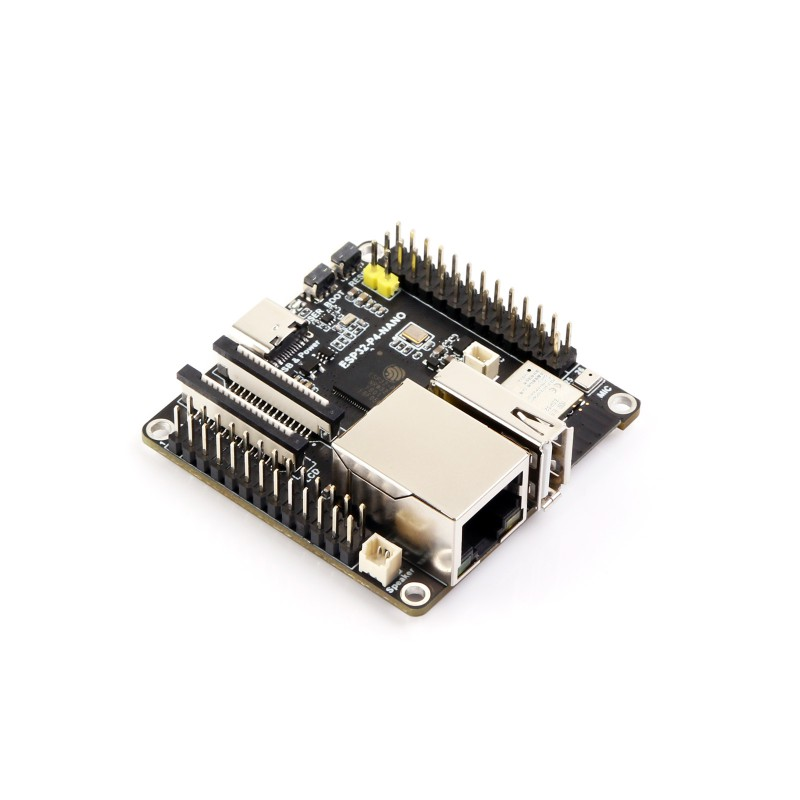
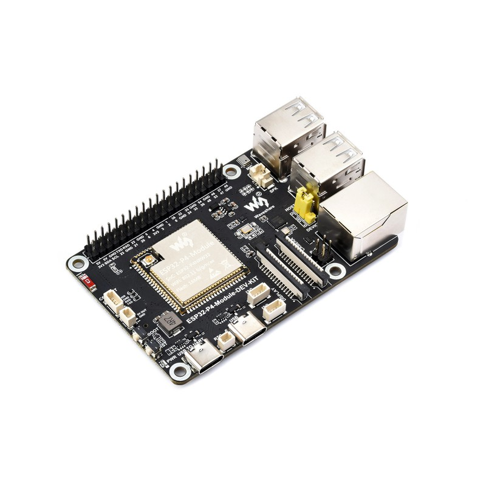
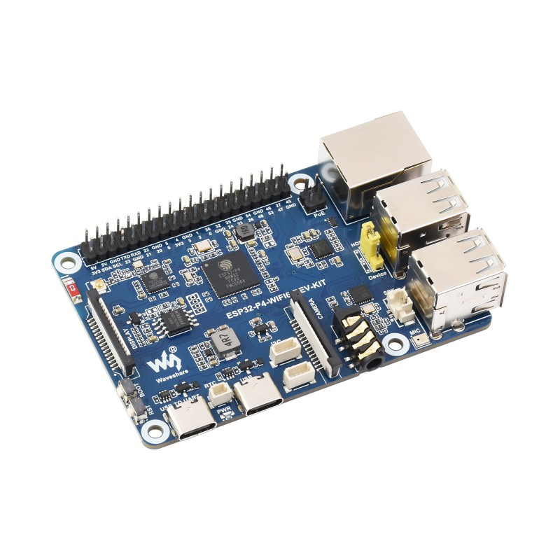
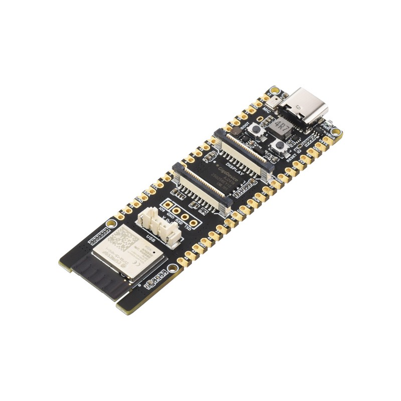
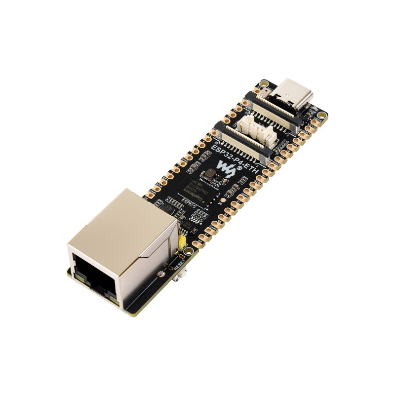
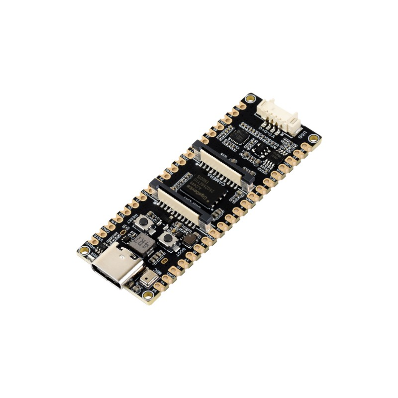
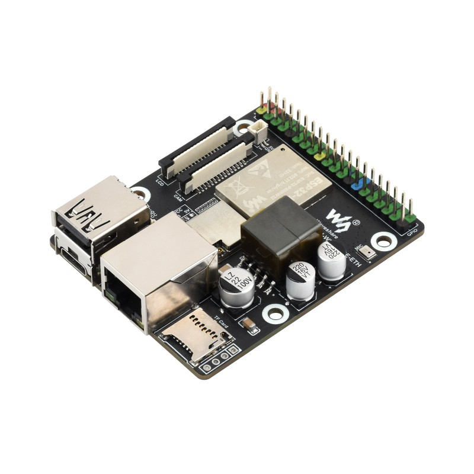
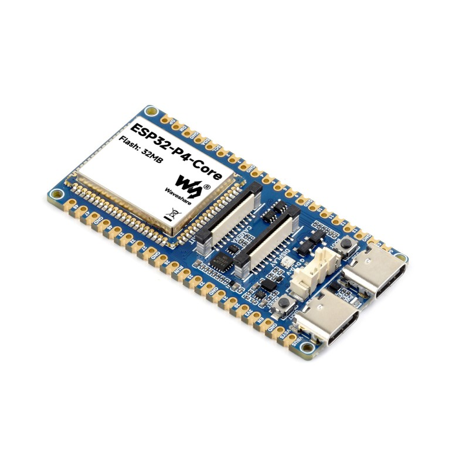

  <h1>ESP32-P4-Platform</h1>
  
<strong>微雪 ESP32-P4 系列开发板的外设与多媒体示例</strong>

  
<a href="README.md">English</a> | <strong>简体中文</strong>

  

    
    
    
  

  

    <a href="https://www.waveshare.com/catalogsearch/result/?q=ESP32-P4">🛒 产品</a> &middot;
    <a href="https://github.com/waveshareteam/ESP32-P4-Platform/releases/latest">📦 固件</a> &middot;
    <a href="examples/esp-idf/">🧩 ESP-IDF</a> &middot;
    <a href="examples/arduino/examples/">🔧 Arduino</a> &middot;
    <a href="https://docs.waveshare.net/ESP32-P4/">📖 文档</a>
  

<table>
  <tr>
    <td align="center" width="25%">
      <a href="https://www.waveshare.com/esp32-p4-nano.htm"> <strong>ESP32-P4-NANO</strong></a> 
      <a href="https://docs.waveshare.net/ESP32-P4-NANO">指南</a>
    </td>
    <td align="center" width="25%">
      <a href="https://www.waveshare.com/esp32-p4-module-dev-kit.htm"> <strong>ESP32-P4-Module-DEV-KIT</strong></a> 
      <a href="https://docs.waveshare.net/ESP32-P4-Module-DEV-KIT">指南</a>
    </td>
    <td align="center" width="25%">
      <a href="https://www.waveshare.com/esp32-p4-wifi6-dev-kit.htm"> <strong>ESP32-P4-WIFI6-DEV-KIT</strong></a> 
      <a href="https://docs.waveshare.net/ESP32-P4-WIFI6-DEV-KIT">指南</a>
    </td>
    <td align="center" width="25%">
      <a href="https://www.waveshare.com/esp32-p4-wifi6.htm"> <strong>ESP32-P4-WIFI6</strong></a> 
      <a href="https://docs.waveshare.net/ESP32-P4-WIFI6">指南</a>
    </td>
  </tr>
  <tr>
    <td align="center" width="25%">
      <a href="https://www.waveshare.com/esp32-p4-eth.htm"> <strong>ESP32-P4-ETH</strong></a> 
      <a href="https://docs.waveshare.net/ESP32-P4-ETH">指南</a>
    </td>
    <td align="center" width="25%">
      <a href="https://www.waveshare.com/esp32-p4-pico.htm"> <strong>ESP32-P4-Pico</strong></a> 
      <a href="https://docs.waveshare.net/ESP32-P4-Pico">指南</a>
    </td>
    <td align="center" width="25%">
      <a href="https://www.waveshare.com/esp32-p4-wifi6-poe-eth.htm"> <strong>ESP32-P4-WIFI6-POE-ETH</strong></a> 
      <a href="https://docs.waveshare.net/ESP32-P4-WIFI6-POE-ETH">指南</a>
    </td>
    <td align="center" width="25%">
      <a href="https://www.waveshare.com/esp32-p4-core-dev-kit.htm"> <strong>ESP32-P4-Core-DEV-KIT</strong></a> 
      <a href="https://docs.waveshare.net/ESP32-P4-Core-DEV-KIT">指南</a>
    </td>
  </tr>
</table>

---

## ✨ 概述

本仓库为微雪 ESP32-P4 系列开发板提供 ESP-IDF、Arduino 示例和出厂演示源码，涵盖基础外设、网络、音频、显示、触摸和摄像头。请按上方板卡资料选择实际硬件及配件。

| 功能 | 器件或接口 |
| --- | --- |
| MCU | ESP32-P4，双核 RISC-V |
| 存储器 | 随板型配备 16 MB 或 32 MB Flash、32 MB PSRAM，容量见各板卡官方规格 |
| 网络 | 依板型提供以太网、ESP32-C6 远程 Wi-Fi |
| 显示与摄像头 | 兼容的 MIPI-DSI 显示屏、MIPI-CSI 摄像头，按示例选配 |
| 板级支持 | ESP-IDF 使用托管组件 `waveshare/esp32_p4_platform`；Arduino 使用随仓库提供的库 |

## 📦 快速开始

首次使用请从 [00_board_check](examples/esp-idf/00_board_check/README_ZH.md) 开始，按示例 README 构建、烧录和查看日志。

1. 安装下表列出的开发框架并克隆本仓库。
2. 按[修订版本指南](docs/ESP32P4_REVISION_CONFIG_ZH.md)选择芯片配置；默认使用 v3.x。
3. 打开所需示例，按其 README 配置实际外设并运行。

已发布的示例固件可从[最新版本](https://github.com/waveshareteam/ESP32-P4-Platform/releases/latest)下载 `*-combined.zip`，解压后按包内 README 烧录。出厂演示源码位于 [examples/factory](examples/factory/README_ZH.md)。

## 🧪 示例

### ESP-IDF

| 示例 | 主要功能 |
| --- | --- |
| [00_board_check](examples/esp-idf/00_board_check/README_ZH.md) | 开发板检查 |
| [01_HowToCreateProject](examples/esp-idf/01_HowToCreateProject/README_ZH.md) | 创建工程 |
| [02_HelloWorld](examples/esp-idf/02_HelloWorld/README_ZH.md) | Hello World |
| [03_nvs_counter](examples/esp-idf/03_nvs_counter/README_ZH.md) | NVS 计数器 |
| [04_freertos_tasks](examples/esp-idf/04_freertos_tasks/README_ZH.md) | FreeRTOS 任务 |
| [05_gpio_io](examples/esp-idf/05_gpio_io/README_ZH.md) | GPIO 输入输出 |
| [06_gpio_interrupt](examples/esp-idf/06_gpio_interrupt/README_ZH.md) | GPIO 中断 |
| [07_uart_loopback](examples/esp-idf/07_uart_loopback/README_ZH.md) | UART 回环 |
| [08_i2c_tools](examples/esp-idf/08_i2c_tools/README_ZH.md) | I2C 工具 |
| [09_sdmmc](examples/esp-idf/09_sdmmc/README_ZH.md) | SDMMC |
| [10_wifistation](examples/esp-idf/10_wifistation/README_ZH.md) | Wi-Fi Station |
| [11_ethernetbasic](examples/esp-idf/11_ethernetbasic/README_ZH.md) | 以太网基础 |
| [12_I2SCodec](examples/esp-idf/12_I2SCodec/README_ZH.md) | I2S 音频编解码器 |
| [13_Displaycolorbar](examples/esp-idf/13_Displaycolorbar/README_ZH.md) | 显示彩条 |
| [14_lvgl_demo_v9](examples/esp-idf/14_lvgl_demo_v9/README_ZH.md) | LVGL v9 示例 |
| [15_eth2ap](examples/esp-idf/15_eth2ap/README_ZH.md) | 以太网转 Wi-Fi AP |
| [16_video_lcd_display](examples/esp-idf/16_video_lcd_display/README_ZH.md) | 摄像头画面显示 |
| [17_simple_video_server](examples/esp-idf/17_simple_video_server/README_ZH.md) | 视频服务器 |
| [18_esp_brookesia_phone](examples/esp-idf/18_esp_brookesia_phone/README_ZH.md) | ESP-Brookesia Phone |
| [19_system_monitor](examples/esp-idf/19_system_monitor/README_ZH.md) | 系统监视器 |

### Arduino

| 示例 | 主要功能 |
| --- | --- |
| [HelloWorld](examples/arduino/examples/HelloWorld/README_ZH.md) | Hello World |
| [AsciiTable](examples/arduino/examples/AsciiTable/README_ZH.md) | ASCII 字符表 |
| [Drawing_board](examples/arduino/examples/Drawing_board/README_ZH.md) | 画板 |
| [GFX_ESPWiFiAnalyzer](examples/arduino/examples/GFX_ESPWiFiAnalyzer/README_ZH.md) | Wi-Fi 分析仪 |
| [LVGLV9_Arduino](examples/arduino/examples/LVGLV9_Arduino/README_ZH.md) | LVGL v9 |
| [Camera_Preview](examples/arduino/examples/Camera_Preview/README_ZH.md) | 摄像头预览 |
| [Camera_ISP_Tuning](examples/arduino/examples/Camera_ISP_Tuning/README_ZH.md) | 摄像头 ISP 调节 |
| [SD_Card](examples/arduino/examples/SD_Card/README_ZH.md) | SD 卡 |
| [Audio_Playback](examples/arduino/examples/Audio_Playback/README_ZH.md) | 音频播放 |

Arduino 环境设置见[环境说明](examples/arduino/README_ZH.md)，草图使用的库位于 [examples/arduino/libraries](examples/arduino/libraries/)。

### ESP-IDF 开发板支持矩阵

图例：`✅` 表示该示例预期可在该开发板上运行。`❌` 表示示例所需外设不可用
或该示例未支持该开发板。

> [!NOTE]
> 本矩阵汇总仓库当前声明的示例支持情况。CI 仅验证编译；板级接口和硬件连接
> 请以上方各开发板的官方产品文档为准。

| 编号 | 示例 | ESP32-P4-NANO | ESP32-P4-Module-DEV-KIT | ESP32-P4-WIFI6-DEV-KIT | ESP32-P4-WIFI6 | ESP32-P4-ETH | ESP32-P4-Pico | ESP32-P4-WIFI6-POE-ETH | ESP32-P4-Core-DEV-KIT |
| --- | --- | :---: | :---: | :---: | :---: | :---: | :---: | :---: | :---: |
| 00 | [board_check](examples/esp-idf/00_board_check/README_ZH.md) | ✅ | ✅ | ✅ | ✅ | ✅ | ✅ | ✅ | ✅ |
| 01 | [HowToCreateProject](examples/esp-idf/01_HowToCreateProject/README_ZH.md) | ✅ | ✅ | ✅ | ✅ | ✅ | ✅ | ✅ | ✅ |
| 02 | [HelloWorld](examples/esp-idf/02_HelloWorld/README_ZH.md) | ✅ | ✅ | ✅ | ✅ | ✅ | ✅ | ✅ | ✅ |
| 03 | [nvs_counter](examples/esp-idf/03_nvs_counter/README_ZH.md) | ✅ | ✅ | ✅ | ✅ | ✅ | ✅ | ✅ | ✅ |
| 04 | [freertos_tasks](examples/esp-idf/04_freertos_tasks/README_ZH.md) | ✅ | ✅ | ✅ | ✅ | ✅ | ✅ | ✅ | ✅ |
| 05 | [gpio_io](examples/esp-idf/05_gpio_io/README_ZH.md) | ✅ | ✅ | ✅ | ✅ | ✅ | ✅ | ✅ | ✅ |
| 06 | [gpio_interrupt](examples/esp-idf/06_gpio_interrupt/README_ZH.md) | ✅ | ✅ | ✅ | ✅ | ✅ | ✅ | ✅ | ✅ |
| 07 | [uart_loopback](examples/esp-idf/07_uart_loopback/README_ZH.md) | ✅ | ✅ | ✅ | ✅ | ✅ | ✅ | ✅ | ✅ |
| 08 | [i2c_tools](examples/esp-idf/08_i2c_tools/README_ZH.md) | ✅ | ✅ | ✅ | ✅ | ✅ | ✅ | ✅ | ✅ |
| 09 | [sdmmc](examples/esp-idf/09_sdmmc/README_ZH.md) | ✅ | ✅ | ✅ | ✅ | ✅ | ✅ | ✅ | ❌ |
| 10 | [wifistation](examples/esp-idf/10_wifistation/README_ZH.md) | ✅ | ✅ | ✅ | ✅ | ❌ | ❌ | ✅ | ❌ |
| 11 | [ethernetbasic](examples/esp-idf/11_ethernetbasic/README_ZH.md) | ✅ | ✅ | ✅ | ❌ | ✅ | ❌ | ✅ | ❌ |
| 12 | [I2SCodec](examples/esp-idf/12_I2SCodec/README_ZH.md) | ✅ | ✅ | ✅ | ✅ | ✅ | ✅ | ✅ | ❌ |
| 13 | [Displaycolorbar](examples/esp-idf/13_Displaycolorbar/README_ZH.md) | ✅ | ✅ | ✅ | ✅ | ✅ | ✅ | ✅ | ✅ |
| 14 | [lvgl_demo_v9](examples/esp-idf/14_lvgl_demo_v9/README_ZH.md) | ✅ | ✅ | ✅ | ✅ | ✅ | ✅ | ✅ | ✅ |
| 15 | [eth2ap](examples/esp-idf/15_eth2ap/README_ZH.md) | ✅ | ✅ | ✅ | ❌ | ❌ | ❌ | ✅ | ❌ |
| 16 | [video_lcd_display](examples/esp-idf/16_video_lcd_display/README_ZH.md) | ✅ | ✅ | ✅ | ✅ | ✅ | ✅ | ✅ | ✅ |
| 17 | [simple_video_server](examples/esp-idf/17_simple_video_server/README_ZH.md) | ✅ | ✅ | ✅ | ✅ | ✅, Ethernet | ❌ | ✅ | ❌ |
| 18 | [esp_brookesia_phone](examples/esp-idf/18_esp_brookesia_phone/README_ZH.md) | ✅ | ✅ | ✅ | ✅ | ✅ | ✅ | ✅ | ✅ |
| 19 | [system_monitor](examples/esp-idf/19_system_monitor/README_ZH.md) | ✅ | ✅ | ✅ | ✅ | ✅ | ✅ | ✅ | ✅ |

## 🛠️ 开发环境

| 开发框架 | 版本 | 示例数 |
| --- | --- | ---: |
| ESP-IDF | `v6.1.1` | 20 |
| Arduino-ESP32 | `3.3.11` | 9 |
| 出厂工程 ESP-IDF | `v6.1.1` | 1 |

版本和 Arduino 开发板选项以 [product.json](.github/product.json) 为准；出厂工程单独构建。

## 📚 资料

- [入门指南](docs/GETTING_STARTED_ZH.md)
- [示例选型与兼容性](docs/EXAMPLES_GUIDE_ZH.md)
- [第三方代码说明](docs/THIRD_PARTY_ZH.md)
- [产品目录](https://www.waveshare.com/catalogsearch/result/?q=ESP32-P4)
- [Wiki](https://docs.waveshare.net/ESP32-P4/)

## 🤝 支持

- 产品使用、硬件或订单问题：[微雪技术支持](https://docs.waveshare.net/ESP32-P4-NANO/Technical-Support/)。

## 📄 许可证

Apache License 2.0，详见 [LICENSE](LICENSE)；第三方组件遵循各自许可证。
