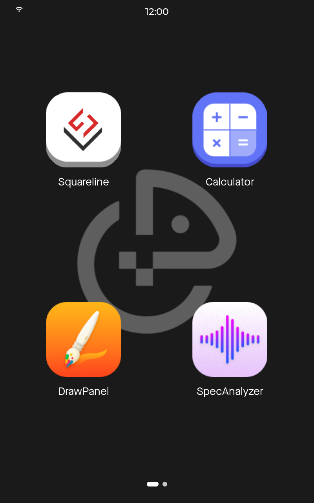
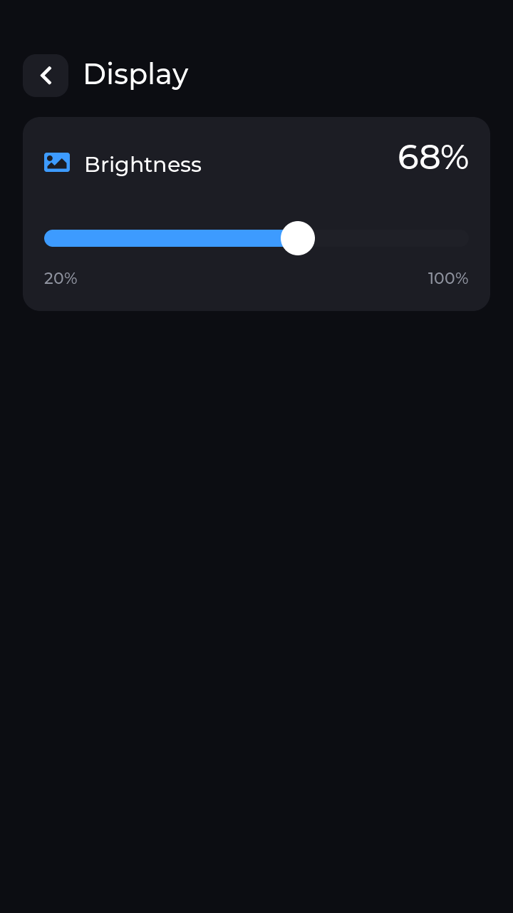

# Factory Demo Source

[English](README.md) | [简体中文](README_ZH.md)

## What It Does

Run the Brookesia launcher on a portrait LCD with board-specific apps for audio, Wi-Fi, and Ethernet. Network-capable boards with audio also get the Xiaozhi voice assistant.

## Hardware Required

An ESP32-P4 board with PSRAM and the display, codec, camera and storage required by the selected apps.

## How to Run

Use the ESP-IDF version in [product.json](../../.github/product.json) and select the [configuration for your board and panel](../../firmware/README.md#build-from-source). The example below builds for the Module-DEV-KIT with 7-DSI-TOUCH-A.

```bash
idf.py -B build-module-7 \
  -D 'SDKCONFIG=build-module-7/sdkconfig' \
  -D 'SDKCONFIG_DEFAULTS=sdkconfig.defaults;sdkconfig.rev3_x.defaults;config/wifi-eth-16.defaults;config/lcd-7-a.defaults' \
  build
```

## Expected Result

Swipe up from the bottom edge to return to the launcher. The Ethernet app shows link speed, DHCP IPv4 and gateway. After connecting to Wi-Fi or Ethernet, open Xiaozhi and enter its activation code at [xiaozhi.me](https://xiaozhi.me/) to start a voice conversation.

| Launcher preview | Brightness control preview |
| --- | --- |
|  |  |

## Troubleshooting

Keep `spiffs/music/` with the project: CMake packs these audio files into the storage partition. Wi-Fi needs C6 slave firmware compatible with the host components; see the [P4 + C6 guide](../../docs/P4_C6_HOSTED_WIFI.md).
