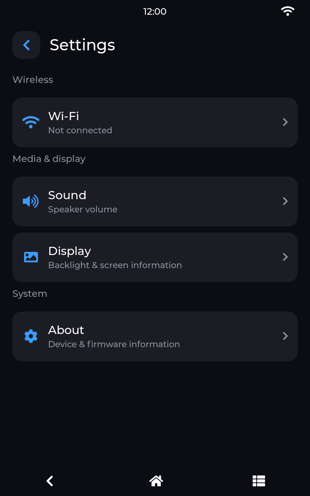

# Factory Demo Source

[English](README.md) | [简体中文](README_ZH.md)

## What It Does

Run the reference Brookesia icon launcher on the 800 x 1280 rectangular portrait display, with calculator, drawing, spectrum, music, camera, video and settings apps. The music view shows the bundled audio file names and provides playback, pause, track selection and a playlist.

## Hardware Required

An ESP32-P4 board with PSRAM and the display, codec, camera and storage required by the selected apps.

## How to Run

Use the factory ESP-IDF version in [product.json](../../.github/product.json), select the actual LCD in menuconfig and build in this directory. The existing defaults select rev3_x silicon, a 10.1-inch 800 x 1280 display and 32 MB flash.

```bash
idf.py set-target esp32p4
idf.py menuconfig
idf.py build flash monitor
```

## Expected Result

The launcher shows four icons per page over the Brookesia wallpaper, with horizontal paging and press animations; settings uses blue controls, while camera and video retain their full-screen views. The images below are software-rendered UI previews.

| Launcher | Settings |
| --- | --- |
|  |  |

## Troubleshooting

Keep `spiffs/music/` with the project: CMake packs these audio files into the storage partition. Wi-Fi needs C6 slave firmware compatible with the host components; see the [P4 + C6 guide](../../docs/P4_C6_HOSTED_WIFI.md).
