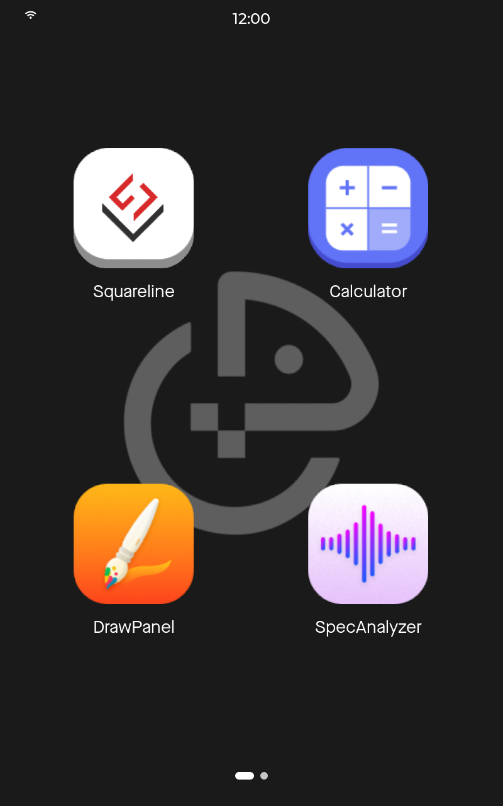
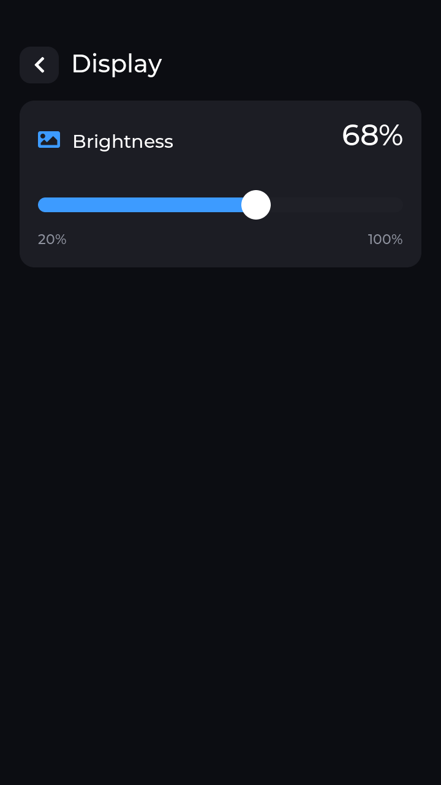

# 出厂演示源码

[English](README.md) | [简体中文](README_ZH.md)

## 功能

在直角竖屏运行 Brookesia 桌面，按板卡提供音频、Wi-Fi 和 Ethernet 应用。带音频且支持联网的板卡还提供小智语音助手。

## 硬件需求

带 PSRAM 的 ESP32-P4 开发板，以及所选应用需要的显示屏、编解码器、摄像头和存储设备。

## 怎么运行

使用 [product.json](../../.github/product.json) 中指定的 ESP-IDF 版本，按[板卡和屏幕选择配置](../../firmware/README_ZH.md#从源码构建)。下例面向搭配 7-DSI-TOUCH-A 的 Module-DEV-KIT。

```bash
idf.py -B build-module-7 \
  -D 'SDKCONFIG=build-module-7/sdkconfig' \
  -D 'SDKCONFIG_DEFAULTS=sdkconfig.defaults;sdkconfig.rev3_x.defaults;config/wifi-eth-16.defaults;config/lcd-7-a.defaults' \
  build
```

## 预期现象

从屏幕底边上划可返回桌面。Ethernet 应用显示网线链路、协商速率、DHCP IPv4 和网关。通过 Wi-Fi 或 ETH 联网后打开小智，到 [xiaozhi.me](https://xiaozhi.me/) 输入屏幕上的激活码，即可开始语音对话。

| 启动器预览 | 亮度调节预览 |
| --- | --- |
|  |  |

## 常见问题

请保留 `spiffs/music/`：CMake 会将其中的音频打包到 storage 分区。Wi-Fi 需要与主机组件匹配的 C6 从机固件，参见 [P4 + C6 说明](../../docs/P4_C6_HOSTED_WIFI_ZH.md)。
